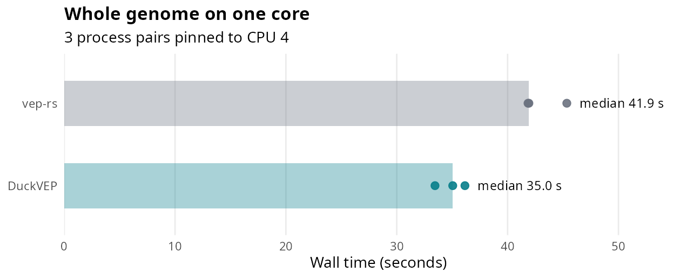
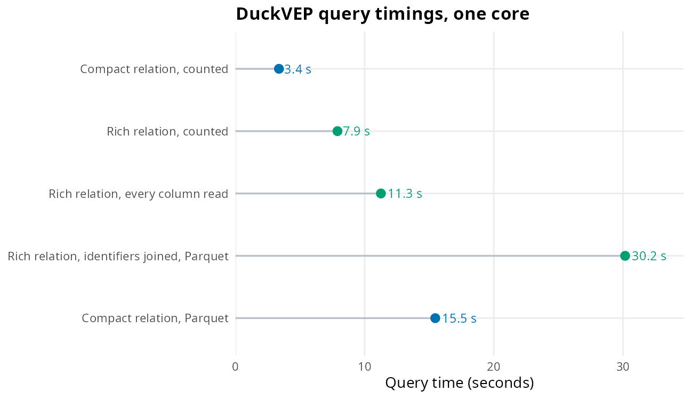
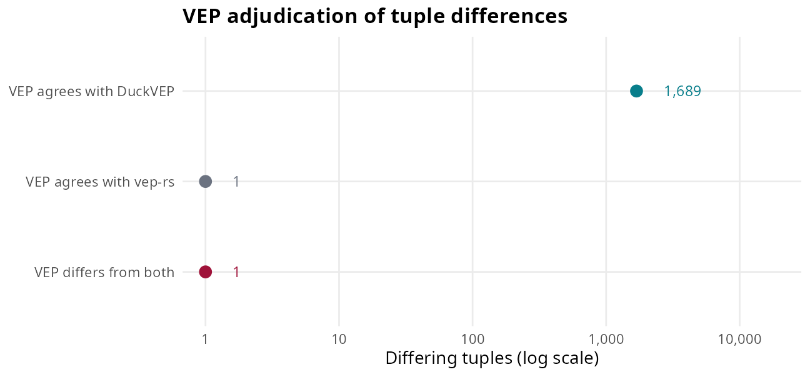

DuckVEP and vep-rs on HG002
================

One sites-only HG002 v4.2.1 GRCh38 genome, split to one ALT allele per
record, annotated with Ensembl 116 transcripts by both tools. DuckVEP
writes its rich typed relation to Parquet; vep-rs writes VEP tab text.
The tools are compared as
`(allele, transcript, sorted consequence terms)` on the transcripts both
emit, and executable Ensembl VEP adjudicates every tuple where they
differ.

|                                                |    DuckVEP |     vep-rs |
|------------------------------------------------|-----------:|-----------:|
| Median wall time, one core                     |     35.0 s |     41.9 s |
| Median CPU time                                |     35.0 s |     39.7 s |
| Median peak memory                             |   2.66 GiB |   2.77 GiB |
| Output rows                                    | 47,278,065 | 36,258,238 |
| Transcripts in output                          |    598,993 |    421,878 |
| Tuples on shared transcripts                   | 34,148,222 | 34,148,222 |
| Differing tuples where VEP sides with the tool |      1,689 |          1 |

34,146,531 of 34,148,222 tuples agree (99.995%). Of the 1,691 that
differ, VEP agrees with DuckVEP on 1,689, with vep-rs on 1, and with
neither on 1.

## Paired single-core timings

The 3 cold-process pairs ran one after another on CPU 4, vep-rs first in
each pair. Each timed process includes startup, extension load, model
snapshot restore, VCF read and sort, annotation, and output. Lines join
the two halves of a pair.

<div class="figure" style="text-align: center">


<p class="caption">
Bars are medians; dots are the individual processes. Outputs were
disk-backed.
</p>

</div>

## Where the time goes in DuckVEP

A separate probe after the pairs times five complete queries on the
restored model. Extension setup and restore are outside these timers,
and the queries are alternatives, not additive steps.

<div class="figure" style="text-align: center">


<p class="caption">
Each point is one separately timed query.
</p>

</div>

## Agreement

<div class="figure" style="text-align: center">


<p class="caption">
VEP verdicts on the differing tuples. The count axis is logarithmic.
</p>

</div>

On the sites where the tools differ, VEP emits 41,249 tuples. DuckVEP
matches 41,085 and vep-rs matches 38,109. VEP has 162 rows on
transcripts DuckVEP’s database-built model does not hold and 1,443 rows
vep-rs does not emit. DuckVEP emits 0 rows absent from VEP and vep-rs
emits 0.

DuckVEP emits 178,557 transcripts that vep-rs does not, because its
model is built from the Ensembl core database while the vep-rs cache is
built from the GTF by `vep-cache-builder`. Agreement is measured only on
the 420,436 transcripts both emit, and tuples on which the tools agree
were not replayed through VEP.

The two tuples where VEP does not side with DuckVEP have [two-record
witnesses](../test/duckvep/conformance/veprs_residual_witness.vcf):

- **`e284879` on `ENST00000696609`.** A deletion across the UTR and
  start codon leaves an upstream `ATG` before the original CDS suffix.
  DuckVEP emits `start_lost` and `start_retained_variant`; VEP and
  vep-rs emit only `start_lost`.
- **`e391762` on `ENST00001011173`.** Deleting the middle base of a
  terminal `TGA` leaves `TA`, and the next base makes `TAG`. DuckVEP
  calls the stop retained, VEP calls it lost, and vep-rs adds a
  frameshift term.

[Diagnostic SQL](../test/duckvep/conformance/veprs_residual_witness.sql)
reproduces DuckVEP’s rows from the runner’s snapshot and mappings; load
the extension and set the SQL variable `comparison_dir` first. Direct
VEP reruns reproduce both oracle rows.

<details>
<summary>
Run design and reproduction
</summary>

Render from the repository root with
`Rscript benchmarks/scripts/render_benchmarks.R vep_rs`. The report
reads the newest `benchmarks/data/vep_rs/*_paired` directory, here
2417ac9_paired, measured at DuckVEP revision 2417ac9.

vep-rs ran its release binary with `--fork 1`. DuckVEP ran with
`SET threads = 1`, so both used one worker on the pinned core. The
adjudicating VEP uses `--gtf` with the same GTF the vep-rs cache was
built from.
[`run_receipt.tsv`](data/vep_rs/2417ac9_paired/run_receipt.tsv) records
the executables and their hashes;
[`preparation.receipt.tsv`](data/vep_rs/2417ac9_paired/preparation.receipt.tsv)
and
[`preparation_outputs.sha256`](data/vep_rs/2417ac9_paired/preparation_outputs.sha256)
bind the inputs and the prepared snapshot. Paths in them locate the
measurement host’s files.
[`timings.tsv`](data/vep_rs/2417ac9_paired/timings.tsv),
[`stage_timings.tsv`](data/vep_rs/2417ac9_paired/stage_timings.tsv) and
[`adjudication.txt`](data/vep_rs/2417ac9_paired/adjudication.txt) are
the raw outputs this page is drawn from.

To reproduce, set `DUCKVEP_READER_EXT`, `DUCKVEP_MODEL`, `VEP_RS_CACHE`,
`VEP_GTF`, `VEP_FASTA` and `VEP_RS_DIR` as described in the header of
[`benchmark_duckvep_vep_rs.sh`](benchmark_duckvep_vep_rs.sh), set
`BENCH_OUT` to the output filesystem, and run:

``` bash
benchmark_duckvep_vep_rs.sh --vcf INPUT.vcf.gz --work WORKDIR --threads 1 --runs 3 --cpu-affinity CPU \
  | tee adjudication.txt
```

`VEP_RS_CACHE` is the species and release directory that contains
`transcripts/`. The runner rejects a vep-rs run that exits cleanly
without annotation rows. Preparation is reused only when its inputs and
generated files match their recorded hashes.

HGVS, regulatory features and plugins are outside this comparison.

</details>
